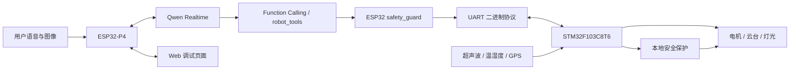

# 双 MCU 多模态 AI 视觉智能小车


基于 **ESP32-P4 + STM32F103C8T6** 的双 MCU 小车工程，结合语音交互、视觉理解、实时运动控制与网页调试。ESP32-P4 处理网络、音视频与 AI 工具调用，STM32 负责电机、云台、传感器和本地安全保护。

本仓库 Fork 自 [waynewong001/DualMCU_AI_Vision_Car](https://github.com/waynewong001/DualMCU_AI_Vision_Car)，保留原始代码和提交历史。本分支整理了中文项目导航与技术说明；功能说明依据仓库实现，不代表已在当前维护者的硬件上完成验证。

## 功能概览

| 模块 | 功能与实现 |
|---|---|
| 多模态交互 | 通过 WebSocket 接入 Qwen Realtime，结合语音与图像进行对话和高层动作决策 |
| 视觉采集 | OV5647 图像采集、JPEG 编码、图像采样与网页画面显示 |
| 音频链路 | ES8311 / I²S 采集与播放，PSRAM 缓冲池和 FreeRTOS Ring Buffer 解耦接收与播放 |
| 行为控制 | 巡逻、云台扫描及非阻塞行为调度，Function Calling 转换为受约束的控制指令 |
| 实时执行 | STM32 管理电机 PWM、舵机、超声波和状态采集 |
| 联调界面 | Web 页面查看设备状态、控制运动与云台，辅助检查通信和 AI 调用 |
| 故障保护 | 校验和检查、通信超时停车、速度与舵机限幅、超声波制动及 AI 异常降级 |

## 系统架构



AI 层输出动作意图，实际执行经过 ESP32 参数检查和 STM32 本地安全判断。网络与模型响应不承担底层 PWM 的实时控制。

## 硬件分工

| 硬件 | 作用 |
|---|---|
| Waveshare ESP32-P4-WIFI6-KIT | 音视频、网络协议、AI 交互与行为编排；当前默认网络配置对应此板卡 |
| 板载 ESP32-C6-MINI-1 | 通过 SDIO / ESP-Hosted 为 P4 提供 Wi-Fi 通信 |
| STM32F103C8T6 | 电机、云台和传感器驱动，通信解析与安全执行 |
| OV5647 | MIPI CSI 摄像头，提供图像输入 |
| ES8311 | 音频 Codec，连接 I²S 音频链路 |
| TB6612 + 直流电机 | 小车行驶控制 |
| Pan / Tilt 舵机 | 双轴云台控制 |
| HC-SR04、DHT11、ATGM336H、WS2812 | 测距、温湿度、GPS 与状态灯 |

硬件型号与接线应结合实际板卡确认，参考 [集成架构](docs/official_project_architecture.md) 和板级配置文件。ESP32-P4 本身不提供原生 Wi-Fi，无线网络由协处理器实现。

## 关键代码入口

| 路径 | 阅读重点 |
|---|---|
| [qwen_realtime_client.c](esp32p4_car_controller/main/qwen_realtime_client.c) | WebSocket 事件、Function Calling 与流式音频处理 |
| [robot_tools.c](esp32p4_car_controller/main/robot_tools.c) | 高层动作入口与参数转换 |
| [behavior_manager.c](esp32p4_car_controller/main/behavior_manager.c) | 非阻塞行为编排与异常处理 |
| [stm32_link.c](esp32p4_car_controller/main/stm32_link.c) | ESP32 与 STM32 数据收发 |
| [STM32 应用层](stm32_motion_controller/User/App) | 运动控制、云台调度与本地安全判断 |
| [STM32 协议层](stm32_motion_controller/User/Protocol) | 串口帧解析、命令分发与校验 |

UART 协议采用 `AA 55 LEN CMD DATA... CHECKSUM` 帧格式，校验是字节累加和的低 8 位。详细字段见 [UART 协议](docs/uart_protocol.md)。

## 获取与构建

```bash
git clone https://github.com/SCr7-gif/DualMCU_AI_Vision_Car.git
cd DualMCU_AI_Vision_Car
```

在已配置的 ESP-IDF 环境中构建 ESP32-P4 工程：

```bash
cd esp32p4_car_controller
idf.py set-target esp32p4
idf.py menuconfig
idf.py build
# 按实际串口替换 COMx
idf.py -p COMx flash monitor
```

STM32 工程包含 STM32CubeMX / Keil 工程及 GCC 构建脚本。在具备对应工具链的 PowerShell 中运行：

```powershell
cd stm32_motion_controller
.\tools\build_stm32_gcc.ps1
```

网络、相机与音频配置参考 [ESP32-P4 工程说明](esp32p4_car_controller/README.md)。Wi-Fi 密码与 Qwen API Key 使用本地 NVS 配置，示例位于 `esp32p4_car_controller/config/`；真实凭据不提交到仓库。

## 联调顺序

1. 检查 STM32 串口帧解析、心跳与超时停车。
2. 架空车轮，分别验证电机、云台、超声波和状态上报。
3. 接通 ESP32-P4 与 STM32，使用 Web 页面验证控制链路。
4. 验证相机、音频、网络后再接入 Qwen Realtime。
5. 测试断网、串口断连、无效指令、近距离障碍等异常场景。

详细测试步骤见 [测试计划](docs/test_plan.md) 和 `docs/` 下各模块联调文档。当前介绍页未新增实车测量结果。

## 来源与许可

原始项目：[waynewong001/DualMCU_AI_Vision_Car](https://github.com/waynewong001/DualMCU_AI_Vision_Car)。本仓库保留 Fork 关系及原作者提交记录。上游当前未提供根目录项目许可证，本分支不另行授予原始项目代码许可；STM32 HAL、CMSIS 等第三方代码保留各自许可证。
