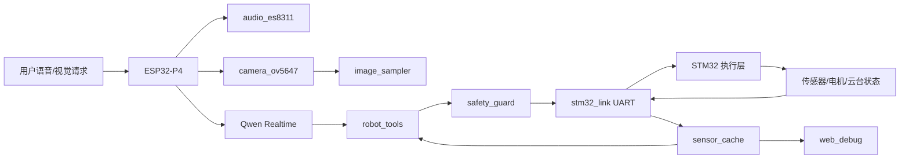

# 双 MCU AI 智能小车正式集成架构

本文档是正式项目集成入口。目标是把已验证的 ESP32-P4 外设能力和 STM32 执行层整合成可逐步编译、烧录、测试的小闭环项目。

## 1. 总体边界

### ESP32-P4：大脑与联网层

负责：

- Qwen3.5-Omni-Realtime WebSocket 通信。
- ES8311 麦克风采集和 NS4150B 喇叭播放。
- OV5647 摄像头初始化、取帧、JPG 压缩。
- 图片上传策略控制：默认不上传，事件触发，默认 1 FPS。
- Qwen Function Calling 工具执行。
- 行为编排：找人、跟随、巡逻、卖萌、睡眠、唤醒。
- Web 调试页面。
- 通过 UART 和 STM32 通信。

ESP32-P4 不能直接控制底层 PWM。它只能向 STM32 发送高层、安全过滤后的命令。

### STM32F103C8T6：执行与最高安全层

负责：

- TB6612 双电机 PWM 和方向控制。
- Pan/Tilt 两个 9g 舵机。
- HC-SR04 超声波测距。
- DHT11 温湿度读取。
- ATGM336H GPS NMEA 接收。
- WS2812 状态灯。
- 通信超时停车、超声波过近停车、急停、Tilt 硬限制、速度上限。

STM32 必须保留最高安全权。即使 ESP32-P4 或 AI 下发错误命令，STM32 也必须拒绝危险动作。

### Qwen3.5-Omni-Realtime：理解与高层决策

负责：

- 语音理解。
- 图像理解。
- 对话回复。
- Function Calling 工具调用。

Qwen 不能直接控制底层 PWM、GPIO 或定时器，只能调用 `robot_move`、`robot_gimbal_action`、`robot_behavior` 等高层工具。

## 2. 数据流



## 3. 正式文件结构

目标结构如下。已有的一阶段测试代码可以保留，但正式功能必须逐步迁入这些模块。

```text
esp32p4_car_controller/
  main/
    app_main.c
  components/
    board_config/
    network_manager/
    qwen_realtime_client/
    audio_es8311/
    camera_ov5647/
    image_sampler/
    stm32_link/
    robot_tools/
    behavior_engine/
    safety_guard/
    sensor_cache/
    web_debug/
    secret_manager/
  config/
    config.example.ini

stm32_motion_controller/
  Core/
  Drivers/
  User/
    App/
      app_main.c
      car_control.c
      gimbal_control.c
      behavior_executor.c
      safety_manager.c
    BSP/
      bsp_motor.c
      bsp_servo.c
      bsp_ultrasonic.c
      bsp_dht11.c
      bsp_gps.c
      bsp_ws2812.c
    Protocol/
      car_protocol.c
      command_handler.c
    Utils/
      ring_buffer.c
      soft_timer.c
      easing.c
  TestOnly/
```

## 4. 模块规则

每个正式模块文件开头必须写中文说明，至少包含：

- 这个模块负责什么。
- 用到什么硬件。
- 初始化函数是什么。
- 主循环或任务里需要调用什么。
- 怎么单独测试。
- 失败时先检查什么。

代码风格要求：

- 不做黑盒封装。
- 不用复杂宏。
- 不用函数指针炫技。
- 关键状态机必须能在面试时讲清楚。
- 不在 CubeMX 自动生成区写业务代码。

## 5. 安全原则

ESP32-P4 侧：

- 工具调用必须先经过 `safety_guard`。
- Tilt 二次限制 30 到 150。
- 速度上限默认不超过 60%，调试可配置。
- 距离过近时拒绝前进。
- Qwen 工具参数异常时拒绝执行并返回错误。

STM32 侧：

- 上电默认停车。
- 急停最高优先级。
- 通信超时停车。
- 超声波小于 15 cm 自动停车。
- Tilt 硬限制 30 到 150。
- 电机速度必须斜坡变化。
- 云台动作必须平滑插值。

## 6. 小闭环开发顺序

每一轮只做一个可编译、可烧录、可测试的小闭环：

1. STM32 正式协议骨架 + 心跳 + 状态回包。
2. STM32 电机 ramp + STOP/低速前进闭环。
3. STM32 DHT11 修复 + 2 秒非阻塞读取闭环。
4. STM32 Gimbal Motion Engine + 回中/左右看闭环。
5. STM32 超声波安全停车闭环。
6. ESP32 `stm32_link` 替换一阶段 UART 测试代码。
7. ESP32 `secret_manager` + Wi-Fi 连接闭环。
8. ESP32 Web 调试页面显示 STM32 状态 + 急停闭环。
9. ESP32 robot_tools 只接入 `robot_stop`、`robot_get_status`。
10. Qwen Realtime 音频 half-duplex 对话闭环。
11. image_sampler 事件触发单张图上传闭环。
12. behavior_engine 非阻塞找人/巡逻/卖萌逐步接入。

任何一步失败，不进入下一步。

